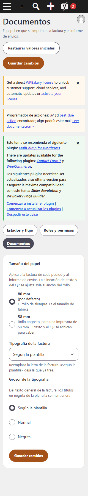
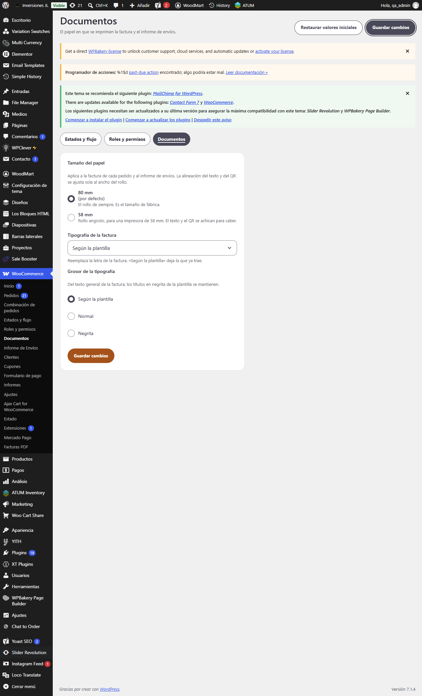
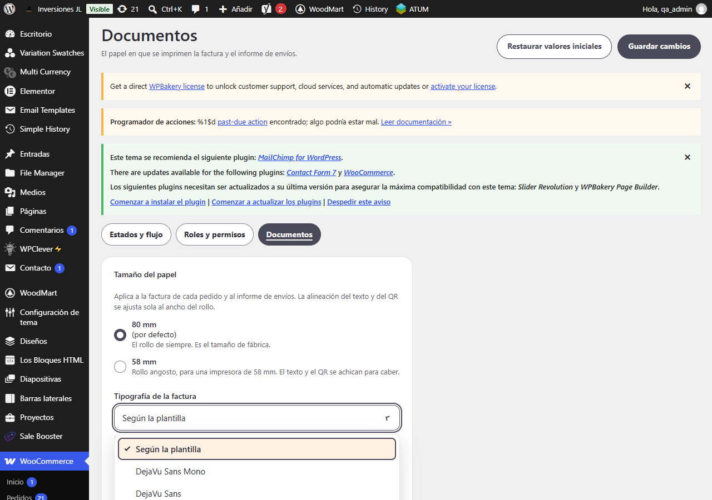
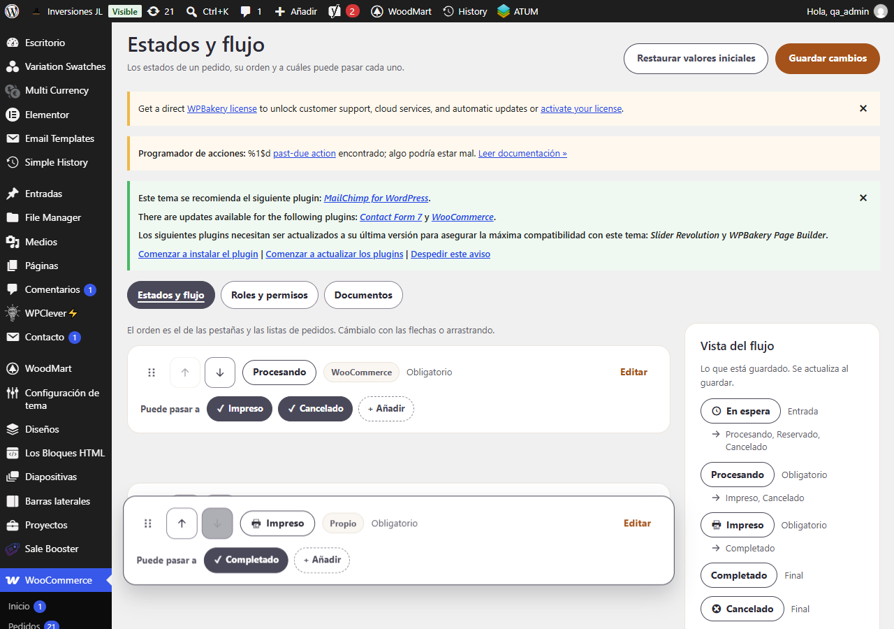
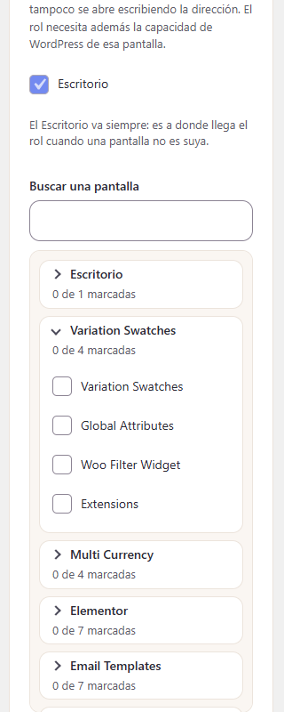
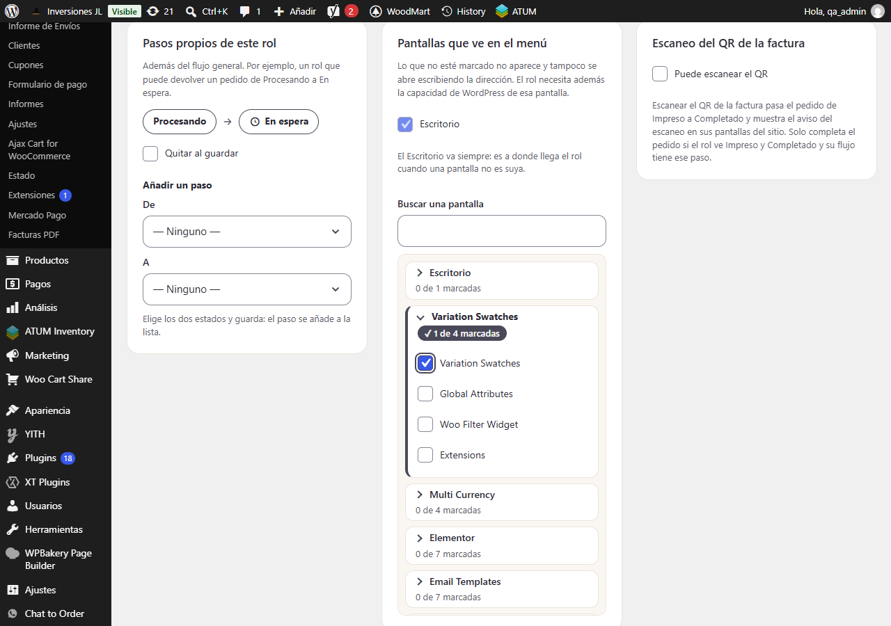
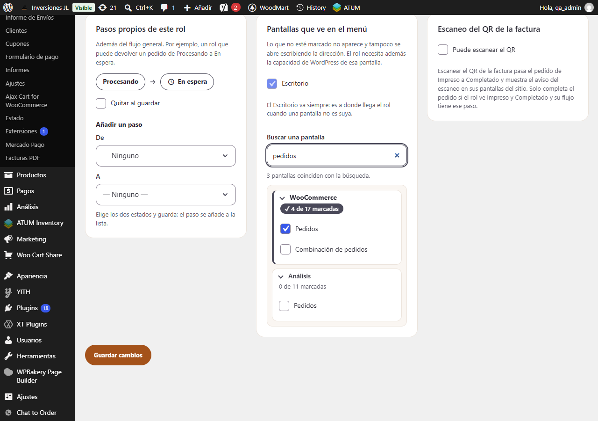

## Qué cambia (F3·8, pulido de la UI de ajustes)

1. **Botones:** sin subrayado en ningún estado (`<a class="jl-button">` incluido); el foco sigue con el anillo de 2 px.
2. **Radios** (papel y grosor en Documentos): relleno pizarra con punto blanco (8,7:1); el punto es la señal que no depende del color.
3. **Selects propios** en Roles (`#jl-role-base`, De/A) y Documentos (tipografía): las pantallas cargan `admin-form.css` y `admin-controls.js`; el select nativo sigue oculto en el formulario y es lo que se envía.
4. **Animación de estados** (FLIP, 200 ms ease-out): flechas y arrastre deslizan a las vecinas; la tarjeta movida se eleva y al arrastrar queda un hueco discontinuo. Con `prefers-reduced-motion` no hay animación. Teclado y foco intactos.
5. **«Pantallas que ve en el menú»:** búsqueda, 42 grupos plegados con «n de m marcadas», rejilla en varias columnas y panel con scroll propio. Los grupos con algo marcado se distinguen por borde grueso, negrita y píldora con ✓. Solo presentación: mismos `menu[]`. La página de un rol pasó de ~13 000 px a ~2 100 px.

No se tocó la «Vista del flujo» ni el guardado/permisos.

## Pruebas (copia local, Edge)
`.qa/pulido-ui.js`: 27 comprobaciones OK — subrayado, foco, radio, selects (teclado, valor enviado), grupos, contador, búsqueda, envío idéntico salvo la casilla marcada, FLIP, arrastre, movimiento reducido, sin scroll horizontal a 320 px, axe sin violaciones en las tres pantallas. `bun run lint:php` OK. No hay SCSS que compilar.

## Capturas
Antes: roles (lista de ~13 000 px) y documentos están en `.qa/shots` locales; abajo, después.

<!-- Capturas en pr-shots@d568ebf -->

**despues-documentos-320**

**despues-documentos-escritorio**

**despues-documentos-select-abierto**

**despues-estados-mover-animando**

**despues-roles-menu-320**

**despues-roles-menu-abierto**

**despues-roles-menu-busqueda**

🤖 Generated with [Claude Code](https://claude.com/claude-code)
