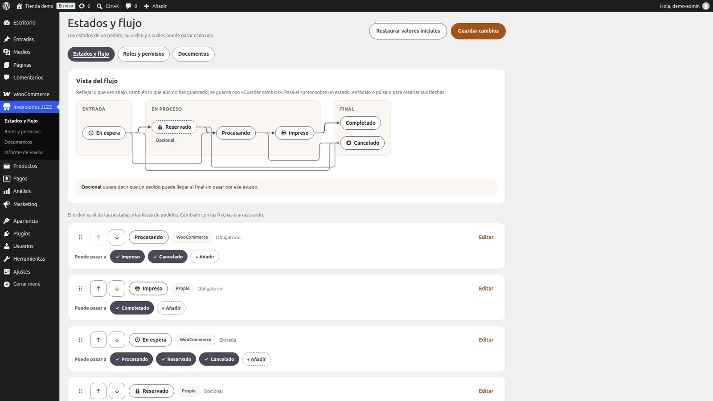
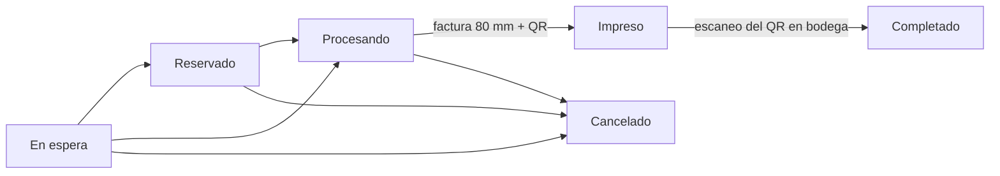

# InversionesJL22 — store operations for WooCommerce

> A WordPress plugin that runs the back office of a Colombian online store: the warehouse
> prints a thermal invoice with a QR code and closes the order by scanning it, and each staff
> role only sees and moves the orders that belong to its step.

*Plugin que lleva la operación interna de una tienda WooCommerce en Colombia: bodega imprime
la factura térmica con QR y cierra el pedido escaneándolo, y cada rol solo ve y mueve los
pedidos de su etapa.*

[Live store](https://inversionesjl22.com) · In production · CI: PHP lint (7.4 and 8.3) and compiled-CSS check



## What it does

- **Warehouse staff** print an 80 mm (or 58 mm) thermal invoice for an order, with the
  shipping details, the payment to collect on delivery and a QR code. Scanning that QR with
  the phone moves the order from *Impreso* to *Completado*, and every warehouse screen that is
  open shows the change within seconds.
- **Each staff role** sees only the orders in its statuses and only the actions its step
  allows. Warehouse (*storage_manager*) sees *Procesando*, *Impreso* and *Completado* and can
  only complete an order by scanning its QR; the SEO team (*seo_manager*) moves orders through
  *En espera*, *Reservado* and *Procesando* but cannot mark them printed or completed. The
  limits apply to the list, quick and bulk actions, the order preview, the edit screen and the
  admin menu.
- **The store owner** edits the order statuses (name, colour, icon), the allowed moves between
  them (shown as a live diagram), the permissions of each role, which roles can close orders
  by QR, and the paper size and typeface of the PDFs, from the plugin's own menu in wp-admin.
- **Staff on a cash-on-delivery order** mark it *Pagado* or *Por cobrar*, with the amount and
  currency (COP or USD) to collect; the invoice prints it, and an order cannot move on until
  it is set.
- **The office** generates a shipping report as a thermal PDF by day, country, carrier and
  time slot, with each order's shipping cost.
- **Staff** combine several orders from the same customer into one, which keeps its lines,
  coupons, shipping and payment status; the originals are kept, linked, in a *Combinado* status.
- **Customers** get their invoice attached to the store's emails and download it from *My
  account*. New products without a SKU get one from their category.

## How it is built

| Layer | Choice |
|---|---|
| Platform | WordPress 7.1 + WooCommerce 11.2, premium theme Woodmart with a child theme |
| Code | One plugin, `inversionesjl22-site`: one file per feature, PHP 7.4-compatible |
| PDFs | Dompdf 3.1.6 and chillerlan/php-qrcode 5.0.5, vendored inside the plugin under its own namespace (no Composer on the host) |
| Data | WordPress options (one config array) and order meta; data changes as numbered migrations |
| Auth | WordPress roles and capabilities, plus the plugin's per-role rules; HMAC-signed QR links |
| Hosting | GoDaddy managed WordPress behind Cloudflare; GitHub Actions deploys over SSH: every merge to staging, production on demand |



*The default flow. The owner can change it from* Estados y flujo.

## Decisions worth noting

**The custom code left a snippets plugin and the theme for a versioned plugin.**
The store's logic lived in 24 WPCodeBox snippets edited live in production, plus a child
theme that was not even active (so its SKU generator never ran). It moved into one plugin in
git, one snippet per commit, in the order WPCodeBox loaded them, because hooks on the same
priority depend on it. A guard keeps the plugin's modules off if WPCodeBox is turned back on,
so the old way stays a working rollback. The cost: the move had to be byte-for-byte faithful
(moved as is) before anything could be improved, and every change since goes through a PR and a deploy
instead of a click.

**The invoices are generated by the plugin, not by the PDF Invoices plugin it started on.**
The thermal templates were edits inside a vendored copy of *WooCommerce PDF Invoices &
Packing Slips*, to be re-applied by hand on every update. The plugin now carries its own copy
of Dompdf and its own template, with paper size and typeface as settings, and a migration
turns the old plugin off. The QR image, which was fetched from a third-party API with the
site URL and the order ID in it, is now drawn locally. The cost: two vendored libraries the
project has to keep up to date itself.

**The QR link is signed per order, and the scan is never cached.**
The site sits behind Cloudflare with anonymous HTML cached for 31 days; after a scan, the
browser could show a cached logged-out home page and staff thought the scan had logged them
out. The scan response now sends no-cache headers and redirects to a unique URL. Separately,
the scan was a plain GET that only checked the role, so any link opened with a warehouse
session could complete an order: the QR now carries an HMAC of the order, and older printed
invoices, without it, get a confirmation page that posts with a nonce. The cost: one extra
tap for invoices printed before the change.

## Quality

- CI on every PR: `php -l` on PHP 7.4 (the plugin's minimum) and 8.3 (the host's), and a check
  that the committed CSS matches its SCSS source.
- Role behaviour is checked by hand with test accounts for each role in a local copy; there
  are no automated tests yet.

## Run it locally

Two copies, both in Docker:

**Demo copy** (invented data, no access needed): WordPress, WooCommerce and this plugin with
12 invented orders, 8 products and one account per role.

```bash
bun install
bun run demo:up        # http://localhost:8090/wp-admin · accounts in .env.demo.local
bun run demo:down
```

**Copy of production** (for the team, needs the hosting's SSH access in `.env.local`, see
`.env.example`): production's files and database, at production's versions, with every email
caught by Mailpit.

```bash
bun run site:pull -- ssh      # production → .site-pull/ (contains customer data: never commit)
bun run local:sync
bun run local:up              # http://localhost:8080 · email at http://localhost:8025
```

Other commands: `bun run lint:php`, `bun run build:css` (SCSS → the committed CSS).

## Project structure

| Folder | What |
|---|---|
| `wp-content/plugins/inversionesjl22-site/` | All the store's code: `includes/` (one file per feature), `templates/pdf/`, `migrations/`, `assets/` |
| `wp-content/themes/woodmart-child/` | The child theme (presentation only) |
| `wp-content/plugins/woocommerce-pdf-invoices-packing-slips/` | The old, modified PDF plugin, kept until it is removed (now deactivated) |
| `wpcodebox/` | Backup of the 24 original snippets the plugin replaced |
| `scripts/` | Pulling the site, the demo copy, lint, screenshots, context backup |
| `context/` | Project context and decisions |
| `.github/workflows/` | CI and the deploy to staging and production |

## My role

César León built all of the store's own code: the order statuses and flow, the per-role
permissions, the invoices and shipping report, the QR closing flow, the move from snippets
to a plugin, and the local, demo and deploy setup. The store itself runs on the Woodmart
theme and WooCommerce.

## License

Private agreement with the client; not open source.
