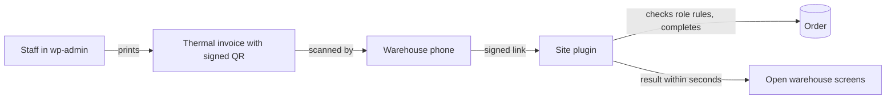

# Inversiones JL22

> The custom operations layer of an online store in Colombia: every order prints a thermal invoice with a QR code, the warehouse closes it by scanning that code, and each staff role sees and moves only the orders that are its own.

*Capa a medida sobre la tienda WooCommerce de un cliente en Colombia: facturas térmicas con QR, cierre de pedidos al escanearlas en bodega,*
*informe de envíos en PDF y permisos estrictos por rol sobre los pedidos.*

[Live store](https://inversionesjl22.com) · In production · [Public case study](https://github.com/Fockus26/inversionesjl22-case-study)

<!-- Screenshots pending (local copy, demo orders only, 1440×900 unless noted):
     docs/readme/orders-by-role.png   the orders list as the warehouse role sees it
     docs/readme/invoice-80mm.png     an 80 mm invoice with its QR code
     docs/readme/qr-scan-phone.png    the scan result on a phone, 390×844
     docs/readme/shipping-report.png  the shipping report form and its PDF -->

## What it does

- Whoever prepares an order prints its invoice on a thermal roll, 80 mm or 58 mm wide, with the order, shipping and payment details and a QR code.
- A warehouse worker scans that code with a phone and the printed order becomes completed. Every warehouse screen that is open shows the result within seconds.
- Each staff role sees only the orders in the stages it works on, and can move an order only along the steps its role allows.
- For orders paid on delivery, staff record whether the order is paid or still to be collected, with the amount and the currency. The order cannot advance without it, and the invoice prints it.
- Staff get a PDF of the shipments completed in a date range, by country, courier and shift, sized for the same thermal printer.
- Several orders of the same customer become one order with one shipment, without counting the stock twice.

## How it is built

The store, its theme and its catalogue already existed. Everything here lives in one custom plugin that hooks into WooCommerce's admin, plus the tooling to work on a production site safely.

| Layer | Choice |
|---|---|
| Platform | WordPress with WooCommerce, on the client's existing premium theme (not modified) |
| Custom code | One site plugin, PHP 7.4-compatible: one file per feature, loaded in an explicit order |
| Order workflow | Two custom order statuses, a flow that says which status an order can come from, and per-role rules for what each role sees and does |
| Documents | Invoices and shipping report rendered to PDF with a bundled, namespaced Dompdf; QR codes generated on the site with chillerlan/php-qrcode |
| Admin UI | Three settings screens (statuses and flow, roles and permissions, documents) in vanilla JavaScript and CSS, no build step |
| Data changes | Numbered migrations that run once, on deploy or on the first admin visit |
| Local copy | Docker Compose at production's WordPress and PHP versions, with outgoing email caught locally |
| Delivery | GitHub Actions: lint on every pull request, rsync over SSH to staging on merge, production by a manual run |



## Decisions worth noting

**Role rules are enforced on the server, not by hiding buttons.**
The first version decided which buttons each role saw. Every endpoint behind those buttons still accepted any status from anyone allowed to edit orders, so a link or a crafted request could complete an order that was never printed. Now each way of changing a status (quick actions, the order preview, bulk actions, saving the order screen) passes through one check of the role's flow and its visible statuses before anything changes, and the invoice endpoint follows the same rules. A role nobody has configured sees no orders at all instead of all of them. The cost: the rules are checked in four places WooCommerce exposes separately, and the shipping report still authorises by a fixed list of roles.

**A QR link that only the site can issue.**
The QR is a plain link, so anyone who knew its shape could put one in front of the warehouse. Each invoice now carries a signature of the order (an HMAC with the site's secret, compared in constant time) and one scan still completes it. A link without a valid signature, which includes every invoice printed earlier, opens a confirmation page whose button posts with a nonce. The code image is generated on the site and written as a PNG with zlib only, so order links are no longer sent to a third-party QR service and the host needs no image extension. The scan response is also never cached: the store sits behind a CDN that keeps anonymous pages for a month, and a cached home page after a scan used to look like a logout. The cost: warehouse screens poll every few seconds to show scans, and the signature depends on the site's secret keys, so rotating them sends every printed invoice through the confirmation step, and it is cut to 80 bits to keep the code readable at 20 mm on the narrow roll.

**Moving 24 database snippets into a versioned plugin without a double run.**
The custom code lived as snippets stored in the database by a snippet plugin, outside git. Each one moved into the site plugin as its own file, in the order the snippet plugin loaded them, because hooks of equal priority depend on it. The plugin checks for a function the snippets declare and loads none of its modules if it finds it, so turning the old snippets back on is a working way back instead of a fatal error. Data changes ship as numbered migrations that store every value they replace. The cost: the modules were moved as they were, so the legacy function names and style remain, and the equivalence was proven by comparing outputs before and after rather than by a test suite.

**Replacing a third-party invoice plugin with the plugin's own PDF engine.**
The invoices came from a vendored invoice plugin whose templates and custom files had to be re-applied by hand on every update. The site plugin now bundles the same Dompdf version under its own namespace and renders invoice and report itself, with a switch: while the old plugin is active, nothing new runs. The output was compared against the old one page by page (same text, same page count, same sheet sizes; the shipping report identical byte for byte apart from its creation date). The cost: about 10 MB of library and fonts committed to git because the host has no build step, one patch to the bundled copy to maintain, and the old plugin's invoice numbering was deliberately not rebuilt because the printed invoice never showed it.

## Quality

- **CI:** every pull request lints all PHP on 7.4 and 8.3 (the oldest version the plugin supports and the one the host runs) and fails if the committed CSS differs from its source.
- **No automated test suite.** Each change was checked on a local copy of the store with browser scripts, signed in with a test account per role; those scripts and their logs are local and not part of the repository.
- **Security on every input** is a project rule: nonce, capability check, sanitised input, escaped output, prepared SQL. A security review of the plugin produced the signed QR and the closed-by-default roles described above.
- **Accessibility:** WCAG 2.1 AA is the project rule for the screens the plugin adds; the QR confirmation page was checked with axe-core and at 320 px.
- **Deploys:** files are swapped in together at the end of the upload, so a request never meets half a plugin; pending migrations run right after. Production is only ever a manual run from `main`.

## Run it locally

The local copy is built from a private backup of the production store (premium theme and plugins, real data), so it only runs for someone with access to that backup. Requires [Bun](https://bun.sh) and Docker.

```bash
bun install
cp .env.example .env.local                             # then fill in the values
bun run site:pull -- <ssh|ftps|archive|dbs|import>     # bring the site down into .site-pull/
bun run local:up                                       # http://localhost:8080, email at http://localhost:8025
bun run local:sync                                     # after each site:pull
bun run local:wp -- <wp-cli command>
bun run local:down
```

Environment variables, by name (see `.env.example`):

- Site: `SITE_URL`, `SITE_PLUGIN`, `CHILD_THEME`, `TABLE_PREFIX`
- Local copy: `LOCAL_URL`, `LOCAL_PORT`, `WP_IMAGE_TAG`, `WPCLI_IMAGE_TAG`
- Database: `DB_USERNAME`, `DB_PASSWORD`, `DB_HOST`, `DB_PORT`
- Test accounts, one per role: `WP_ADMIN_*`, `WP_STORAGE_MANAGER_*`, `WP_SEO_MANAGER_*`
- Access to pull the site: `PULL_SSH*` or `PULL_FTP_*`, `PULL_PATH`, `STAGING_SSH*`, `HOSTING_*`

Other commands: `bun run lint:php`, `bun run build:css`.

## Project structure

```
wp-content/plugins/inversionesjl22-site/   The custom plugin: all of the project's own code
  includes/        One file per feature: statuses, transitions, roles, QR scan, invoices, settings screens
  includes/shipping-report/   The report's form, query and PDF
  migrations/      Numbered data migrations, run once each
  templates/pdf/   The invoice template
  assets/          Admin JavaScript, CSS, the fonts the PDFs embed
  vendor/          Bundled Dompdf and QR library, under the plugin's own namespace
wp-content/plugins/woocommerce-pdf-invoices-packing-slips/   Vendored invoice plugin, being retired
wp-content/themes/woodmart-child/          Earlier version of the customisations; not active
wpcodebox/         Backup of the original 24 snippets, the source of the move
scripts/           Site pull, PHP lint, pull-request screenshots
docker-compose.yml The local copy
.github/workflows/ CI and the staging and production deploy
context/           Project context and decision records
```

## My role

Built for Inversiones JL22, on a WordPress and WooCommerce store the client already had. I did not build the store, its theme or its catalogue. I developed the custom layer: the order statuses and flow, the per-role permissions, the thermal invoices with their QR code, the warehouse scan, the shipping report and order combining; then moved that code from database snippets into a versioned plugin with settings screens, migrations, a local copy and a deploy pipeline.

At the time of writing, the plugin with the order workflow, the role rules, the QR scan and the shipping report is in production. The settings screens, the plugin's own PDF engine and order combining are on the staging site awaiting the client's review, and the signed QR is in code review.
